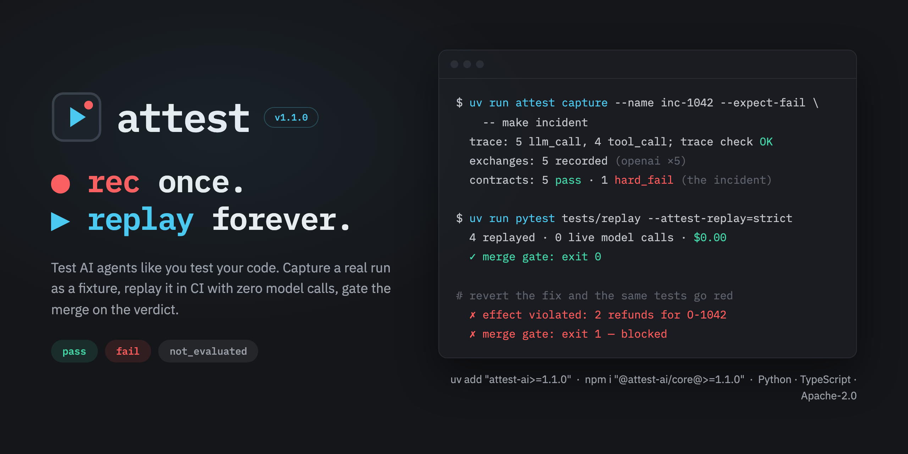

[](https://attest-framework.github.io/)

---

# Attest

**Test your AI agents like you test your code.**

[Documentation](https://attest-framework.github.io/) | [Examples](https://github.com/attest-framework/attest-examples) | [Contributing](CONTRIBUTING.md)

[](https://github.com/attest-framework/attest/actions/workflows/ci.yml)
[](https://pypi.org/project/attest-ai/)
[](https://www.npmjs.com/package/@attest-ai/core)
[](LICENSE)

Attest is an open-source testing framework purpose-built for AI agents and LLM-powered systems. It treats deterministic assertions as first-class citizens alongside probabilistic evaluation. Deterministic checks run first; model-scored checks run last.

> **Status:** v1.1.0 "Hardened" — capture real agent runs, replay the current code without model calls, and gate merges on evaluated assertions, behavior contracts and test outcomes in Python and TypeScript.

## How it works in 30 seconds

Record a real run once as a fixture. In tests, run your agent's current code against the recorded model replies, then check its output, tool calls and side effects. A policy turns the test report into a merge decision; deterministic checks need no model or API key.

---


## Why Attest

The current ecosystem defaults to LLM-as-judge for everything. This creates cost explosion, flaky tests, and slow suites. Attest provides six evaluated layers plus plugins, ordered from free and deterministic (layers 1–4) to model-scored (layers 5–6, whose cost depends on the configured provider), and reaches for the cheapest valid assertion first. The table below is generated from `attest-engine capabilities --json`.

<!-- claims:layers:start -->
| Layer | Name | Checks | Assertion types | Cost | Deterministic |
| --- | --- | --- | --- | --- | --- |
| 1 | Schema validation | Checks the output against a JSON Schema. | `schema` | free | yes |
| 2 | Constraint checks | Checks cost, token, latency and step-count limits. | `constraint` | free | yes |
| 3 | Trace and behavioral checks | Checks which tools ran, in which order, with which arguments, how often per business key, across the agent tree and against the world's final state. | `trace`, `trace_tree`, `effect` | free | yes |
| 4 | Content pattern matching | Checks the output text against substrings, patterns and keywords. | `content` | free | yes |
| 5 | Embedding similarity | Scores semantic similarity against a reference with an embedding model: OpenAI embeddings are paid, the local ONNX model is free. | `embedding` | depends on provider | no |
| 6 | LLM-as-judge | Scores the output against a rubric with a judge model: OpenAI, Anthropic and Gemini judges are paid, a local ACP agent or an OpenAI-compatible local endpoint is not. | `llm_judge` | depends on provider | no |
| plugins | Plugins | Custom assertions that run in the SDK process; cost and determinism are the plugin's. | `plugin` | plugin-defined | no |
<!-- claims:layers:end -->

## What It Looks Like

```python
from attest import agent, expect
from attest.plugin import AttestEngineFixture


@agent("refund-agent")
def refund_agent(builder, order_id):
    builder.add_tool_call(
        "lookup_order",
        args={"order_id": order_id},
        result={"status": "delivered", "amount": 89.99},
    )
    builder.add_tool_call(
        "process_refund", args={"order_id": order_id}, result={"refund_id": "RFD-001"}
    )
    builder.set_metadata(cost_usd=0.005, total_tokens=150, latency_ms=1200)
    return {
        "message": "Your refund of $89.99 has been processed.",
        "structured": {"refund_id": "RFD-001"},
    }


def test_refund(attest: AttestEngineFixture) -> None:
    result = refund_agent(order_id="ORD-123456")

    chain = (
        expect(result)
        # Layer 1 — schema (free, instant)
        .output_matches_schema({"type": "object", "required": ["refund_id"]})
        # Layer 2 — constraints (free, instant)
        .cost_under(0.05)
        # Layer 3 — trace (free, instant)
        .tools_called_in_order(["lookup_order", "process_refund"])
        # Layer 4 — content (free, instant)
        .output_contains("refund")
        .output_not_contains("sorry")
    )

    attest.evaluate(chain)
```

`attest.evaluate(chain)` sends the whole chain to the engine and fails the test on any hard failure, with the layer, expected and actual value of each failed assertion. Add `.passes_judge("Is the response helpful?")` (layer 6) when a deterministic check cannot express the requirement; without a configured judge it is reported as not evaluated and the test is skipped with the reason, never passed.

## Architecture

Attest follows a **protocol-first, engine-centric architecture** inspired by LSP and Playwright:

- **Core engine** (Go) — single binary, handles all evaluation, assertion, and simulation logic
- **Language SDKs** (Python, TypeScript) — thin, idiomatic wrappers that communicate with the engine via JSON-RPC 2.0 over stdio
- **Protocol** — SDK spawns engine as subprocess; each SDK release requires the engine version equal to its own (see [configuration](docs/guides/configuration.md))

```text
SDK (Python/TS) ──stdin/stdout──▶ Engine Process (Go)
                                        ├── Trace Processor
                                        ├── Assertion Pipeline (6 layers + plugins)
                                        ├── Result History (SQLite)
                                        ├── Drift Detection (σ-based)
                                        ├── Simulation Runtime
                                        └── Report Generator
```

## Key Features

Each feature carries a maturity tier; the table is generated from `attest-engine capabilities --json`.

<!-- claims:features:start -->
| Feature | Maturity |
| --- | --- |
| Capture, replay and merge gate | stable |
| Behavior and world-effect contracts | stable |
| CI policy, baselines and reports | stable |
| Failure viewer | beta |
| Mutation testing | beta |
| MCP server and agent skills | beta |
| LLM judges on four provider families | beta |
| Multi-agent trace trees | beta |
| Simulation runtime | beta |
| Plugin assertions | beta |
| Local ONNX embeddings | experimental |
| Continuous eval and drift detection | experimental |

- **stable**: Covered by the parity and conformance suites; a change in behavior is a breaking change.
- **beta**: Shipped and tested, but the interface or behavior can still change in a minor release.
- **experimental**: Shipped without a stability commitment and without demonstrated demand; it can change or be removed in any release.
<!-- claims:features:end -->

- **Six evaluated layers plus plugins** — layers 1–4 are free and deterministic; layers 5–6 are model-scored and cost what their provider costs
<!-- claims:adapters:start -->
- **10 Python adapters** — OpenAI (stable), Anthropic (stable), Manual (stable), Gemini (beta), Ollama (beta), LangChain (beta), CrewAI (beta), OpenTelemetry (beta), Google ADK (experimental), LlamaIndex (experimental)
- **7 TypeScript adapters** — OpenAI (stable), Anthropic (stable), Manual (stable), Gemini (beta), Ollama (beta), LangChain.js (beta), OpenTelemetry (beta)
<!-- claims:adapters:end -->
- **Capture and real-code replay** — turn a run or incident into a verified fixture and a regression test; `attest capture --refresh` shows semantic differences in prompts, tools, messages, results, model and parameters. Guides: [capture](docs/guides/capture.md), [replay](docs/guides/replay.md)
- **Behavior and world-effect contracts** — check tool order, cardinality per business key and external side effects; relational `sum` and `matches` checks compare refunds with order totals or notification recipients with customers. Guides: [behavior contracts](docs/guides/behavior-contracts.md), [world fixtures](docs/guides/world-fixtures.md)
- **Evaluated-chain enforcement** — building `expect()` / `attestExpect()` is not enough: unevaluated chains fail tests, including fixture-built chains and concurrent Vitest test bodies. Evaluate again after adding assertions. Guide: [verdicts](docs/guides/verdicts.md)
- **CI policy, baselines and reports** — stable assertion IDs (scheme 2) track checks across runs; gate on assertion regressions, removed baseline assertions and failed native tests (`tests_failed`, blocking by default); invalid report input exits 3. Render JUnit, PR summaries and annotation rows, or select tests from a diff. Guides: [policies](docs/guides/policies.md), [baselines](docs/guides/baselines.md), [annotations](docs/guides/annotations.md), [selection](docs/guides/selection.md)
- **Mutation testing** — mutate recorded behavior without model calls, inspect surviving mutants and suggested contracts, and gate on `min_mutation_score`; reports include generated, killed, survived and inapplicable counts and scores per operator. Guide: [mutation](docs/guides/mutation.md)
- **Failure viewer** — one self-contained offline HTML page shows failing spans, expected versus actual values, replay provenance, costs, baseline differences and mutation results. Guide: [viewer](docs/guides/viewer.md)
- **Fail-closed judges on four provider families** — OpenAI, Anthropic, Gemini and local-only ACP, plus OpenAI-compatible endpoints; malformed replies and rejected credentials are `not_evaluated`, not passes, and only transient failures are retried. This only warns under the default merge policy: use `not_evaluated: block` to block. Guides: [judges](docs/guides/judges.md), [policies](docs/guides/policies.md)
- **Budgets and calibration** — assert on run cost, tokens and latency; cap soft failures with `ATTEST_MAX_SOFT_FAILURES`, judge requests with `ATTEST_MAX_JUDGE_CALLS`, and Attest-initiated model spend with `ATTEST_BUDGET_USD` (custom prices: `ATTEST_JUDGE_PRICE_IN` / `ATTEST_JUDGE_PRICE_OUT`). Repeat judge scores, probe bias and persist calibrated thresholds with `attest calibrate --persist`. Guides: [judges](docs/guides/judges.md), [configuration](docs/guides/configuration.md)
- **Safe offline tests** — strict replay rejects unknown model requests; `--attest-egress=block` (TypeScript: `ATTEST_EGRESS=block`) blocks external HTTP, including through HTTP proxies. Guides: [replay](docs/guides/replay.md), [capture](docs/guides/capture.md)
- **Python and TypeScript SDKs** — Python ≥3.10 with pytest; TypeScript with Vitest 3, 4 or 5, CJS/ESM core output and typed assertions. Shared capabilities and documented exceptions are checked by a generated [parity matrix](docs/guides/parity.md); see [framework adapters](docs/guides/framework-adapters.md) for provider integrations.
- **Agent-facing CLI, MCP and skills** — machine-readable commands and schemas, offline `attest guide`, six project-confined MCP tools and installable coding-agent skills. `attest doctor` checks engine and provider configuration. Guides: [CLI](docs/guides/cli.md), [MCP](docs/guides/mcp.md), [agents](docs/guides/agents.md)
- **Merge-gate scaffolding** — `attest init` writes a passing sample and policy; `--ci github` adds a SHA-pinned workflow with a least-privilege annotation job. The 1.1.0 scaffold still pins `pr-annotate` to v1.0.1. Guide: [merge gate](docs/guides/merge-gate.md)
- **Multi-agent trace trees** — check delegation, cross-agent behavior, timing and aggregate metrics. Guide: [multi-agent](docs/guides/multi-agent.md)
- **Simulation and plugins** — simulated users, personas, mock tools, fault injection and multi-turn orchestration; custom SDK-process assertions through Python entry points or TypeScript package discovery. Guide: [simulation](docs/guides/simulation.md)
- **Local ONNX embeddings** — optional all-MiniLM-L6-v2 semantic similarity without API charges. Guide: [configuration](docs/guides/configuration.md)
- **Continuous evaluation and history** — sample production traces, store results in SQLite with retention, and detect drift with webhook/Slack alerts. Guide: [continuous evaluation](docs/guides/continuous-eval.md)
- **Single binary engine** — a version-matched Go subprocess handles evaluation for both SDKs over JSON-RPC; no Go runtime installation is needed. Guide: [configuration](docs/guides/configuration.md)

## Repository Layout

```text
attest/
├── proto/              # Protocol specification (JSON-RPC 2.0)
├── engine/             # Core engine (Go)
│   ├── cmd/            # CLI entrypoint
│   ├── internal/       # Assertion pipeline, trace model, simulation
│   └── pkg/            # Public Go packages
├── sdks/
│   ├── python/         # Python SDK (PyPI: attest-ai)
│   └── typescript/     # TypeScript SDK (npm: @attest-ai/core)
├── .github/
│   └── actions/        # Reusable composite actions (setup-attest)
├── docs/               # Documentation
├── examples/           # Standalone example projects (incl. CI workflows)
└── scripts/            # Build and development scripts
```

## Quick Start

No API key, model or network access is needed: the sample test checks a recorded agent run with deterministic assertions.

### Python

<!-- snippet: skip reason="installs packages or runs npm tooling (network)" -->
```bash
uv init --bare my-agent-tests && cd my-agent-tests
uv add "attest-ai>=1.1.0" pytest
uv run attest init
uv run pytest
```

`pytest` prints `1 passed`. `attest init` wrote `tests/test_my_agent.py` and `attest.policy.yaml`. The test checks a refund agent's run, built by hand with `TraceBuilder` in the `my_agent_result` fixture:

```python
"""Sample Attest test written by `attest init`. Run it with `pytest`.

`my_agent_result` is the trace of one agent run, built by hand with TraceBuilder, so
the sample needs no model, API key or network. Replace it with a trace from your
agent: wrap the agent with @attest.agent or record it with an adapter such as
attest.OpenAIAdapter.
"""

from __future__ import annotations

import pytest

from attest import Trace, TraceBuilder, expect
from attest.plugin import AttestEngineFixture


@pytest.fixture
def my_agent_result() -> Trace:
    return (
        TraceBuilder(agent_id="refund-agent")
        .set_input(user_message="Please refund order ORD-1001.")
        .add_tool_call(
            "lookup_order",
            args={"order_id": "ORD-1001"},
            result={"status": "delivered", "amount": 42.0},
        )
        .add_tool_call(
            "issue_refund",
            args={"order_id": "ORD-1001", "amount": 42.0},
            result={"refund_id": "RF-1001"},
        )
        .set_output(
            message="Your refund of $42.00 has been issued.",
            structured={"refund_id": "RF-1001", "amount": 42.0},
        )
        .set_metadata(total_tokens=180, cost_usd=0.002, latency_ms=900)
        .build()
    )


def test_my_agent(attest: AttestEngineFixture, my_agent_result: Trace) -> None:
    chain = (
        expect(my_agent_result)
        .output_matches_schema({"type": "object", "required": ["refund_id"]})  # layer 1: schema
        .cost_under(0.01)  # layer 2: constraint
        .tools_called_in_order(["lookup_order", "issue_refund"])  # layer 3: trace
        .output_contains("refund")  # ATTEST-DEMO: change "refund" to "store credit"
    )
    attest.evaluate(chain)
```

Change `"refund"` to `"store credit"` on the line marked `ATTEST-DEMO` and run `uv run pytest` again: `1 failed`, exit code 1, with the failed assertion's layer, expected and actual value:

```text
Attest diagnostic — 1 of 4 assertions failed:
  FAIL assert_2d1d647b — L4 content
      trace path: output.message
      expected:   contains "store credit"
      actual:     Your refund of $42.00 has been issued.
```

### Gate merges on it

`--attest-report` writes every test with its outcome, file and line, and every assertion result, as a report-v2 JSON file (`proto/attest/v1/report-v2.schema.json`). `attest policy evaluate` checks it against `attest.policy.yaml`: exit 0 passes, 1 blocks (a hard failure), 2 warns (assertions not evaluated), 3 means the policy or report could not be loaded or the arguments were invalid.

<!-- snippet: setup=project -->
```bash
uv run pytest --attest-report=attest-report.json
uv run attest policy evaluate --report attest-report.json --policy attest.policy.yaml
uv run attest init --ci github
```

`attest init --ci github` writes `.github/workflows/attest.yml`: the test step records its outcome and continues, the report upload, policy evaluation and the `pr-annotate` action always run, and a last step fails the job when the tests failed. Failures are annotated at the failing test's file and line. See the [merge gate guide](docs/guides/merge-gate.md).

In 1.1.0, the generated workflow still pins `pr-annotate` to v1.0.1; the engine and SDK install remains 1.1.0.

### TypeScript

<!-- snippet: skip reason="installs packages or runs npm tooling (network)" -->
```bash
npm init -y && npm pkg set type=module
npm install -D "@attest-ai/core@>=1.1.0" "@attest-ai/vitest@>=1.1.0" "vitest@^4"
npx attest init
npx attest doctor
npx vitest run
```

`npx attest init` writes `tests/my-agent.test.ts` and `attest.policy.yaml`; the line marked `ATTEST-DEMO` works the same way. `npx vitest run --reporter=default --reporter=@attest-ai/vitest/reporter --outputFile.attest=attest-report.json` writes the report and `npx attest init --ci github` writes the workflow, which installs with `npm ci` from the `package-lock.json` that `npm install` writes.

Run `npx attest doctor` before the first Vitest run: it downloads and checks the matching engine. On a cold home directory, doing that inside the first test can exceed Vitest's 5-second timeout. Vitest 3, 4 and 5 are supported.

### Build from source

See [CONTRIBUTING.md](CONTRIBUTING.md) to build the engine and run the SDK test suites.

## Release history

| Release | Theme |
| --- | --- |
| 0.1 | Go engine with deterministic checks, Python SDK and pytest integration |
| 0.2 | Embeddings, LLM judges, soft failures and CI integration |
| 0.3 | Simulation, multi-agent testing, TypeScript SDK and framework adapters |
| 0.4 | Continuous evaluation, drift detection, plugins and result history |
| 0.5 | Unified engine/SDK versions, performance work and TypeScript parity |
| 0.6 | SDK access to drift queries, simulated users and dynamic thresholds |
| 0.9 | Judge calibration, repeat scoring, bias probes and OpenTelemetry GenAI parity |
| 1.0.0 | First stable capture → real-code replay → merge-gate workflow, agent tools and mutation testing |
| 1.0.1 | "Red stays red": request routing, parallel-run reports and fail-closed policy inputs |
| 1.1.0 | "Hardened": fail-closed judges, evaluated-chain enforcement, relational effects, semantic refresh diffs and stronger policy gates |

See [CHANGELOG.md](CHANGELOG.md) for release details and upgrade behavior changes.

## Contributing

See [CONTRIBUTING.md](CONTRIBUTING.md) for development setup, workflow, and code standards.

## License

[Apache License 2.0](LICENSE)
